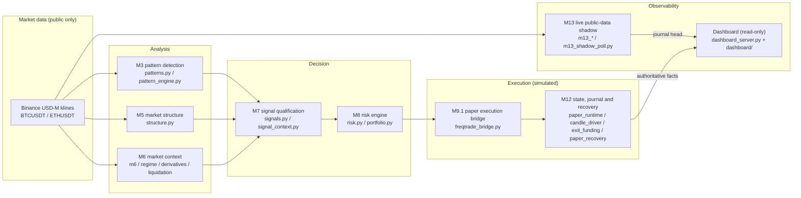
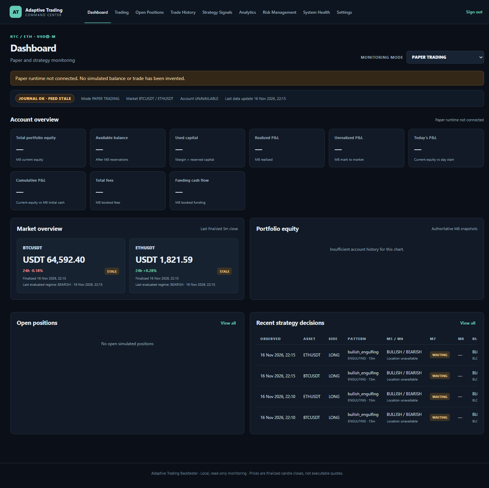
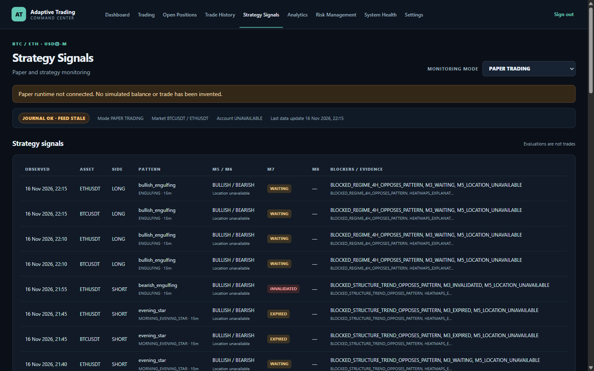

# Adaptive Crypto Trading System

A modular Python framework for **researching** and **paper-executing** adaptive, multi-timeframe
cryptocurrency strategies on Binance USD-M market data — with deterministic simulated-execution
accounting, journaled persistence, crash recovery, and a local read-only monitoring dashboard.

> **Honest status:** this is a research and paper-execution framework, not a live trading system.
> There is **no real-money execution path** in the codebase — no code anywhere creates, modifies,
> or cancels orders, changes leverage, or moves funds. The strategy has **not** been validated
> historically and no profitability is claimed. Live market data is processed today in *shadow*
> mode only (evaluation without execution).

## What this repository demonstrates

- Python backend engineering: typed, decimal-safe, side-effect-controlled core logic
- Cryptocurrency infrastructure: Binance USD-M public market-data ingestion (finalized candles,
  pair synchronization, stale-data handling, duplicate/out-of-order rejection)
- Strategy architecture: pattern detection → market structure → multi-timeframe context →
  signal qualification → risk approval → simulated execution — as composable, testable stages
- Risk infrastructure: user-selected aggressive risk policy (planned loss ≤ 10% of current
  equity per trade, `Decimal` arithmetic, enforced at the execution boundary)
- Reliability patterns: append-only journals, deterministic replay, hash-pinned source closure,
  crash recovery, fail-closed projections
- Operational tooling: local read-only authenticated web dashboard backed by the real journal

## What this is not

- Not financial advice; not a profitable-strategy claim; not a hosted service
- No exchange API keys are required for the core verification path; no network is needed for the test suite
- The live path is **shadow evaluation** — M7 decisions journaled without execution. Shadow ≠ paper trading.
- The strategy's edge is **unvalidated**: no historical dataset is tracked and no backtest evidence of
  positive expectancy exists yet.

## Architecture



### Pipeline stages

| Stage | Module | Role | Verification |
|---|---|---|---|
| M3 | `trading/pattern_engine.py`, `patterns.py`, `pattern_context.py` | Pattern recognition (engulfing, doji, stars, haramis…) with lifecycle: detect → confirm → expire/invalidate | Unit + live shadow (journal) |
| M5 | `trading/structure.py` | ATR-normalized structure, meaningful levels, location gating | Unit + live shadow |
| M6 | `trading/m6.py`, `m6_data.py`, `m6_adapters.py`, `regime.py`, `derivatives.py`, `liquidation.py` | 4h regime, 1h direction, volatility/volume context, optional derivs | Unit + live shadow |
| M7 | `trading/signals.py`, `signal_context.py` | Signal qualification: confluence, contradictions, lifecycle (WAITING/REJECTED/EXPIRED/INVALIDATED/QUALIFIED); replay protection | Unit + live shadow (52 decisions journaled) |
| M8 | `trading/risk.py`, `portfolio.py` | Risk approval, position sizing, exposure limits, **10% planned-loss budget** (`Decimal`), rejection paths | Unit (integration wired; not yet live) |
| M9.1 | `trading/freqtrade_bridge.py` | Simulated order bridge: propose → admit → fill lifecycle; full-quantity contracts | Unit (integration wired; not yet live) |
| M9.2 | `trading/notifications.py`, `notification_outbox.py` | Offline notification previews; no network, no delivery | Unit |
| M9.3 | `trading/orchestration.py`, `replay_journal.py` | Offline orchestration + deterministic replay | Unit |
| M10 | `trading/validation.py`, `walk_forward.py` | Metrics & chronological walk-forward evaluation of completed backtest artifacts | Unit |
| M11 | — | Historical dataset + validation | **Not implemented** |
| M12 | `trading/paper_runtime.py`, `paper_state.py`, `paper_execution.py`, `paper_journal.py`, `paper_recovery.py`, `candle_driver.py`, `exit_funding.py`, `replay_codec.py`, `paper_runtime_journal.py` | Paper state, accounting, journal, crash recovery, funding, exits | Unit + audit |
| M13 | `trading/m13_*.py`, `m13_public_poll.py`, `m13_shadow_poll.py` | Live public-data ingestion, paired BTC/ETH processing, shadow journaling | **Live verified 2026-11-16** (25 pairs) |

The legacy M0–M2 research backtester (`backtest.py`, `strategy.py`, `trading/data.py`,
`trading/ledger.py`) predates the M3+ pipeline and is kept as a reference point. It is not evidence
of current strategy performance.

## Engineering highlights

- **Determinism** — journals persist committed facts; recovery replays them chronologically and
  bit-compares outcomes. Evidence: `docs/M12-*.md`, `tests/test_paper_runtime.py`.
- **Money in `Decimal`** — no float money math. The planned-loss budget is computed from current
  portfolio equity at the moment of the stop, not from invested capital.
- **Fail-closed dashboard** — unreadable, quarantined, or source-incompatible journals render
  explicit UNAVAILABLE/ERROR states. No value is ever filled in from thin air.
- **Read-only everything** — M13 ingests public endpoints only; the dashboard has no order route;
  the optional real-account panel is a single signed read-only `GET /fapi/v2/account`.
- **Hash-pinned release closure** — `trading/paper_runtime.py` pins the source files whose hash
  identifies a release to the recovery path; mismatch → refusal, not guessing.

## Requirements

- Python **3.13** (development/test interpreter; newer 3.x unverified)
- `pandas>=2.1`, `numpy>=1.26`, `pyarrow>=14` (`requirements.txt`)
- No other services. No database server. SQLite files are local artifacts.

## Setup

```bash
git clone https://github.com/sahilmhatre4796/adaptive-crypto-trading-system.git && cd adaptive-crypto-trading-system
python -m venv .venv && . .venv/Scripts/activate   # Windows
# source .venv/bin/activate                         # macOS/Linux
pip install -r requirements.txt
```

## Run the test suite

```bash
python -B -m unittest discover -s tests
```

Verified 2026-11-16: **Ran 522 tests in ~250s, OK (exit 0).** The suite runs without exchange
credentials; network-touching components are exercised through mocks and patched transports.

## Run the legacy research backtest (offline)

```bash
python backtest.py --csv data/BTCUSDT_5m.csv --start 2021-01-01 --end 2026-01-01 \
  --capital 2000 --out runs/btc_5m
```

Writes `summary.json`, `trades.csv`, `equity.csv`, `signals.csv`, `fills.csv`, `funding.csv`,
`risk_equity.csv`. Synthetic-fixture evidence only — this does **not** validate the strategy.

## Run the live public-data shadow (observes, never executes)

```bash
python -B m13_shadow_poll.py --journal runs/shadow.sqlite --max-pairs 25
```

Consumes finalized BTC/ETH 5m klines from Binance USD-M **public** endpoints, evaluates M3–M7,
journals decisions, and exits/rotates on schedule. It cannot place orders (no such code path),
cannot approve risk, and cannot fill. Shadow mode is **not** paper trading.

## Run the dashboard (read-only)

```bash
export DASHBOARD_PASSWORD=change-me-locally     # Windows PowerShell: $env:DASHBOARD_PASSWORD='...'
python -B dashboard_server.py --shadow-journal runs/m13-shadow-2h-final-20261116.sqlite
# open http://127.0.0.1:8765
```

Design notes and missing-data contract: [`docs/DASHBOARD.md`](docs/DASHBOARD.md).

| Dashboard (paper mode — paper runtime not connected) | Strategy signals (journal-backed) |
|---|---|
|  |  |

## Repository layout

```
backtest.py            Legacy M0–M2 research runner (offline)
m13_public_poll.py     Public kline poller (inspection tool)
m13_shadow_poll.py     M7 shadow evaluation over public candles
dashboard_server.py    Local read-only authenticated monitoring server
dashboard/             Dashboard UI (vanilla HTML/CSS/JS, no build step)
trading/               M3–M13 implementation (analysis, risk, execution, journaling, recovery)
tests/                 unittest suite (522 tests, offline)
docs/                  Module design and architecture documentation
runs/                  Local journals & artifacts (git-ignored)
```

## Limitations (read this before trusting anything)

1. **Not profitability-validated.** No historical dataset is tracked; M10 is built but has nothing
   to score. Zero qualified signals in the 2026-11-16 live shadow window are *policy-deterministic*
   (unapproved shadow policy with all `GroupCaps` at 0), not evidence of anything either way.
2. **No approved trading policy.** Score caps, contradiction rules, TP1/TP2 multiples, fee/slippage/
   funding model, and INR-vs-USDT accounting are all explicitly unapproved. The user-selected
   10% planned-loss risk policy is honored and displayed, but remains experimental.
3. **Shadow ≠ paper.** The live path has never exercised M8 risk approval or M9.1 fills end-to-end.
4. **Hash closure gap.** `trading/paper_recovery.py` carries its own 9-file pin separate from the
   22-file pin in `trading/paper_runtime.py`. Not a silent hole — both refuse on mismatch — but
   the release-closure story is incomplete.
5. **Dependencies unpinned.** Only lower bounds in `requirements.txt`; a `pyarrow` transitive
   surface exists via pandas. Environments are not yet identity-pinned.
6. **Python 3.13 only verified.** Encoding/platform behavior on other versions is untested.

## Roadmap

- [ ] M11: curated, provenance-checked historical dataset + walk-forward validation
- [ ] Approve shadow → paper policy/accounting (currency, FX source, fee model, TP multiples)
- [ ] First trade-enabled M13 run (fresh journal): M7 → M8 → M9.1 → exit → P&L, with recovery replay
- [ ] Release integrity: dependency pins, environment identity pin, unified hash closure
- [ ] Dashboard: CI for the auth/CSP contract; accessibility audit (axe); favicon; responsive fixes
- [ ] Packaging: proper `pyproject.toml`, console entry points

## Security & privacy

- No credentials are required for the documented verification path; the dashboard password is a
  local, process-scoped secret via environment variable only.
- `.env`, journals (`*.sqlite`), logs and `runs/` are git-ignored. They are not part of this
  repository and must never be committed.
- There is no code path that can place, modify, cancel or leverage orders, or move funds.
- Security-relevant behavior of the dashboard (auth, CSP, session handling, read-only surface) is
  covered by `tests/test_dashboard*.py`.

## Disclaimer

This repository is software for strategy research and simulation. It does not provide investment
advice. Nothing here is a recommendation to trade. Simulated results do not predict real results.

## License

No license file is present yet — the default is all-rights-reserved. Add a permissive license
(e.g. MIT) before others reuse this code.
