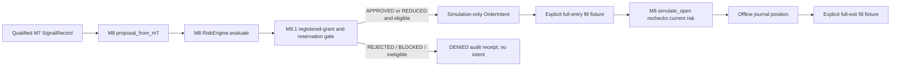

# M9.1 — Offline Freqtrade integration foundation

Baseline: clean master at M8 `a68aec67ca96171d470a7a7826a96d2c89e12017`, preserving M7 `0e7c8b84ef540ad1c4774746ed84849893d8ddd4`. All 97 tracked M0–M8 files were SHA-256 recorded in ignored `runs/m91-preservation.json` before implementation. This stage adds new files only and stays uncommitted for independent OpenCode review. M9.2/M9.3 are not authorized by this implementation.

## Scope and architecture

`trading/freqtrade_bridge.py` defines an offline, sequential `FreqtradeSimulationBridge`, immutable `PairBinding`, `OrderIntent`, `AdmissionReceipt`, `SimulationFill`, `SimulationCancellation` and `LifecycleEvent`. `tests/test_freqtrade_bridge.py` supplies deterministic fixtures using real M7/M8 engines and explicit synthetic venue/cost/FX settings. Coordination status and fresh transcripts are under `docs/coordination/M9.1-*`.

The bridge is a **local M9.1 contract**, not Freqtrade's REST, strategy, callback or exchange-order schema. There is no Freqtrade import, runtime strategy subclass, client, callback registration, package installation, API request, Telegram integration, credential or execution connection. Pair labels are supplied by the caller and have not been validated against a Freqtrade version or venue. No network/provider documentation research was performed under the offline-only restriction. Runtime compatibility, version/licensing assessment and installation approval remain later work, not implemented features.

No layer changes M7 qualifications or M8 sizing, formulas, configuration identity or the user-selected experimental **10% of current equity** planned-loss ceiling. INR 2,000 / INR 200 remain the M8 defaults; every additional limit, cost, instrument rule and FX observation still comes from explicit M8 inputs.

## Approval boundary

`FreqtradeSimulationBridge(risk, bindings)` requires an actual connected `RiskEngine` and a nonempty immutable tuple of unique explicit BTC/ETH pair bindings. Each binding contains `symbol`, `pair`, `stake_currency='USDT'`, and `source`. Missing or ambiguous mappings fail. One bridge owns each M8 actor for its lifetime via an integration-only ownership marker; it does not alter M8 source, methods or policy. Restart/policy comparisons require fresh actors and causal replay.

`submit_signal(record, spec, costs, *, leverage, as_of, events=(), requested_quantity=None)` uses the existing M8 `proposal_from_m7` adapter, then M8 `evaluate`, then the same `propose` gate used for previously evaluated decisions. It accepts the actual M7-v1 `SignalRecord` interface, not a fabricated `SignalDecision` or a raw dictionary. Mandatory M8 inputs have no bridge defaults. M7's score/confidence never bypasses risk assessment.

The `events` iterable is copied to a tuple and validated by the existing M8 adapter. Available matching terminal events are also delivered through `on_signal_terminal` **before** evaluation, including when the formation was already admitted. This revokes a previous pending intent rather than merely rejecting a retry while leaving the old grant usable. Future terminal observations are ignored until available. Lifecycle delivery and a subsequent sizing request are separate causal operations: an acknowledged terminal event is not rolled back if later sizing inputs fail validation. The caller must supply the complete received lifecycle stream.

`propose(decision, *, as_of)` requires the exact immutable decision content to exist in the connected M8 actor's authoritative history with matching M8-v1 schema and configuration ID. A payload merely claiming APPROVED, a modified authentic decision, an unknown actor's record, raw M7 record or arbitrary intent cannot authorize an order. Serialized dictionaries are not imported as grants.

APPROVED and REDUCED are positive M8 grants. Both retain exactly the granted quantity; REDUCED never restores the original requested size. A matching active reservation must identify the same allocation, signal, instrument, quantity, modeled entry/stop and planned risk, and respect the original budget. Expired, stale, canceled or mark/FX-changed reservations produce DENIED receipts without an intent. REJECTED and BLOCKED preserve their M8 status/reasons in DENIED receipts and cannot receive fills.

An accepted intent is a **conditional simulation proposal**, not a fresh risk reevaluation or actual order. Before every entry booking, the bridge checks its own state and active reservation and calls **RiskEngine.simulate_open**, preserving M8's current equity, capital, concentration, drawdown, cooldown, freshness and immutable-mark/FX guards. Old receipts cannot bypass those checks. An expired/ineligible admission does not automatically release the M8 reservation; explicit M8 cancellation/terminal delivery remains required if no M9 order was admitted.

## Units and exported models

All records are frozen dataclasses. `OrderIntent`, `AdmissionReceipt` and `LifecycleEvent` expose `to_dict()` using M8's canonical Decimal-string / ISO-timestamp normalizer. Schema is `M9.1-v1` on intents; all emitted intents set `simulation_only=True`. There is no wire deserializer or untrusted-object authentication mechanism. Connected engines/journals and caller-owned typed objects are a trusted in-process boundary, not a security sandbox.

| Record | Fields |
| --- | --- |
| PairBinding | symbol, pair, stake_currency, source |
| OrderIntent | schema_version, order_id, binding, created_at, expires_at, data_valid_until, side, entry_action, quantity_contracts, amount_base, notional_quote, stake_quote, entry_price, source_stop_price, modeled_stop_execution_price, leverage, allocation, risk, simulation_only |
| AdmissionReceipt | receipt_id, available_at, disposition, reason_codes, risk, order |
| SimulationFill | fill_id, order_id, phase, quantity, price, fee_rate, observed_at, available_at, source |
| SimulationCancellation | cancellation_id, order_id, reason, observed_at, available_at, source |
| LifecycleEvent | event_id, order_id, signal_id, risk_decision_id, allocation_id, kind, previous_state, state, available_at, observed_at, source_available_at, source_id, source_fingerprint, reason_codes, portfolio_event_id, fill, cancellation |

`quantity_contracts` and fill `quantity` use the explicit instrument's contract units. `amount_base = contracts * multiplier`; `notional_quote = modeled_entry * amount_base`; `stake_quote = reserved entry margin in account currency / explicit account-per-USDT FX`. Thus INR margin is not mislabeled as USDT stake, and contract count is not silently mislabeled as base amount. Pair/BUY/SELL labels are descriptive fields, not order API instructions. LONG maps to BUY entry, SHORT to SELL entry.

The original `RiskDecision` and `Allocation` are retained in every intent, including M7 signal/formation/decision/configuration/input identities, source availability and expiry, side, stop, modeled prices, costs, equity/budget and rejection/reduction reasons. `source_stop_price` is the original M7 level; `modeled_stop_execution_price` includes M8 execution assumptions and is **not an exchange stop trigger**. No callback-specific stop-loss percentage or order payload is inferred.

## Deterministic simulation lifecycle

Allowed state changes are PROPOSED → OPEN → CLOSED, or PROPOSED → CANCELLED/EXPIRED. `state(order_id)` returns the current replay state; historical states are in immutable events. `orders`, `receipts` and `history` return immutable tuples.

`process_fill(fill, *, as_of)` accepts only a known admitted order with an authoritative M8 grant. ENTRY requires PROPOSED state, a source observation at/after intent creation, processing strictly before upstream expiry, the full approved quantity, and exactly the M8-modeled entry price and fee rate. Changed prices/fees, partial fills and oversized fills fail before booking. There is no partial-fill accumulation, resizing, automatic repricing or inferred execution from candle highs/lows.

Successful entry creates an ENTRY_FILLED event with state OPEN and links the M8 portfolio booking ID/allocation ID. This event is also the position-open lifecycle record. Delayed fills retain original observation and receipt timestamps, while M8 books at the actual processing cutoff; nothing is backdated. An entry observed before expiry but received/processed at or after expiry is rejected, not retroactively inserted.

EXIT requires OPEN state and the matching authoritative full position. It accepts an explicitly supplied complete simulated exit price (slippage already included once) and fee rate. The original approved quantity cannot be exceeded or partially closed. Fresh explicit FX is required for account-currency exit accounting. M8's journal records the exit; EXIT_FILLED with state CLOSED is also the position-close lifecycle record. Risk-reducing exits are not blocked merely because source entry validity expired or a terminal notice arrived. Exit fills are assumed caller-supplied simulation facts, not authenticated exchange executions.

`cancel(request, *, as_of)` requires a known PROPOSED order and an available request observed at/after intent creation. It releases only the matching M8 reservation, preserving M8's consumed signal/formation. At/after order expiry its state is EXPIRED; otherwise CANCELLED. OPEN/CLOSED/canceled orders cannot be canceled again under a new command identity.

`expire(order_id, *, as_of)` requires the actual cutoff to reach upstream expiry. It generates a simulation-clock cancellation observed now, rather than backdating to the expiry deadline. Repeated expiration returns the original terminal event. Fill attempts after cancellation/expiry cannot reopen an order.

`on_signal_terminal(event, *, as_of)` feeds available typed M7 INVALIDATED/EXPIRED events into M8. Pending M9 orders become CANCELLED/EXPIRED; OPEN positions retain OPEN state with a linked terminal notice. No exit is fabricated or executed by that notice. Already-terminal states are retained. Observed price close, original source availability, source event ID/reason and processing time are preserved independently. Future or causally malformed terminal evidence is rejected. A notice is also safe to synchronize after the same event was already acknowledged by M8.

M9 position changes must go through the bridge. External mark/FX/funding observations remain M8 inputs, but out-of-band opens/closes can desynchronize M9 state. Such conflicting state fails loudly during fills/terminal synchronization and requires a causal replay; M9 does not falsely cancel an already-open position or report OPEN after an external close. No automatic reconciliation protocol is implemented.

## IDs, duplicate handling and failure semantics

Configuration IDs include schema namespace, M8 configuration identity and canonical pair bindings. Order IDs hash that identity, authoritative risk decision ID and allocation ID. Receipt IDs also include actual admission cutoff; lifecycle IDs include order, event kind, source command identity/fingerprint and actual processing cutoff. There are no random IDs or implicit wall-clock reads.

One admission is recorded per risk decision. Identical later proposal calls return the original immutable receipt, even if its order has since terminated; that historical receipt is not new permission and does not emit another order. Fills/cancellations/upstream terminal callbacks deduplicate by command kind plus source ID. Exact repeats at nondecreasing cutoffs return the original result without rebooking; changed payload under an existing command ID raises. Duplicate callbacks cannot reopen a closed order. Processing cutoffs cannot precede bridge history or public M8 risk/terminal/portfolio history.

Individual fill/cancel commands validate before calling the existing atomic M8 booking operation and append local events only after success. An M8 rejection/exception leaves the local lifecycle unchanged; invalid/future/stale callbacks are not fingerprinted as processed and can be correctly replayed from original available history. Stale FX never becomes zero or an assumed rate. Active M8 reservations are retained on a failed entry; cancellation is explicit. Failures are surfaced as exceptions or a DENIED admission with deterministic reason codes, not silently ignored fills or newly inferred positions.

No durable restart database, multi-process locking, external idempotency key store, provider reconciliation, partial exits, wallet settlement emulator or Freqtrade runtime compatibility is implemented. Rebuild fresh M7/M8/M9 actors and replay the complete original ordered observations/commands for deterministic recovery. Do not replay current quotes or current-only evidence into old decision timestamps.

## Verification and next gate

Focused fixtures cover actual M7→M8 handoff, APPROVED/REDUCED/REJECTED/BLOCKED, forged/unknown grants, no-approval fills, exact sizes and units, explicit FX/cost/rules, both sides, full entry/exit cost reconciliation, partial/drift rejection, cancellation/expiry, stale/future data, duplicate/revised callbacks, dynamic M8 rechecks, out-of-band position conflicts, terminal revocation, prefix/future mutation, deterministic replay and JSON-safe immutable output. A complete simulation lifecycle passes with sockets disabled. All fixtures are synthetic and use no runtime APIs.

Fresh results and preservation checks are recorded in `docs/coordination/M9.1-TESTS.txt` after execution. No formatter/linter/type-checker is configured; no tooling was installed. M9.1 must receive independent review before any M9.2/M9.3 work. This foundation makes no paper-trading-readiness or profitability claim.

Final fresh verification: **28 focused M9.1 tests passed in 0.695 seconds; 301 complete-suite tests passed in 27.793 seconds**, with no failures or errors. This includes all 273 pre-existing M0–M8 tests unchanged. Both runs used `PYTHONDONTWRITEBYTECODE=1` and `python -B`. Source/test AST parsing and five-file whitespace checks passed. Complete additions were reviewed; all 97 pre-existing tracked file hashes remain identical, HEAD remains the M8 baseline, and the index is empty. Five new M9.1 files remain untracked for independent review.
